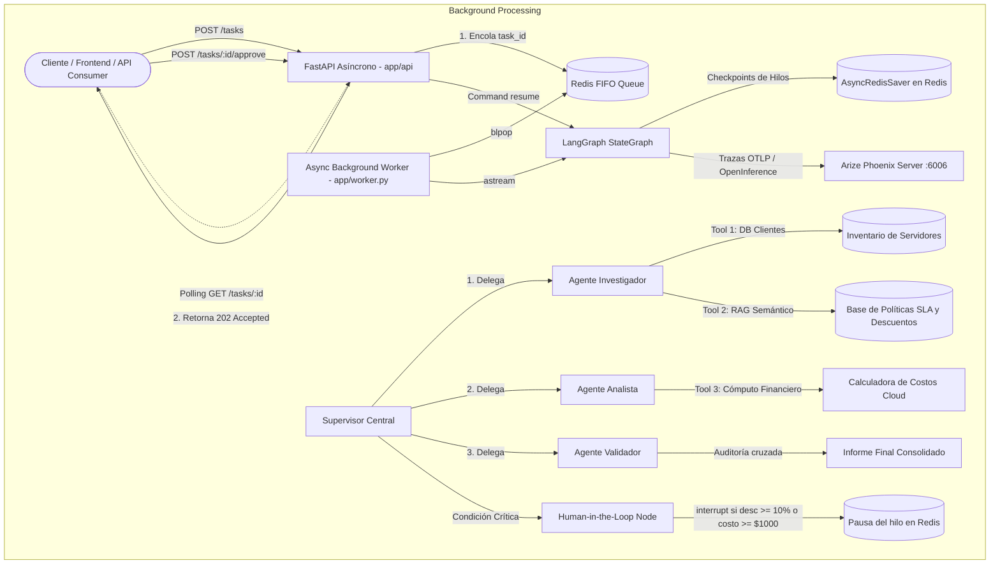
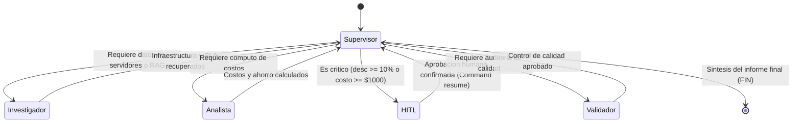
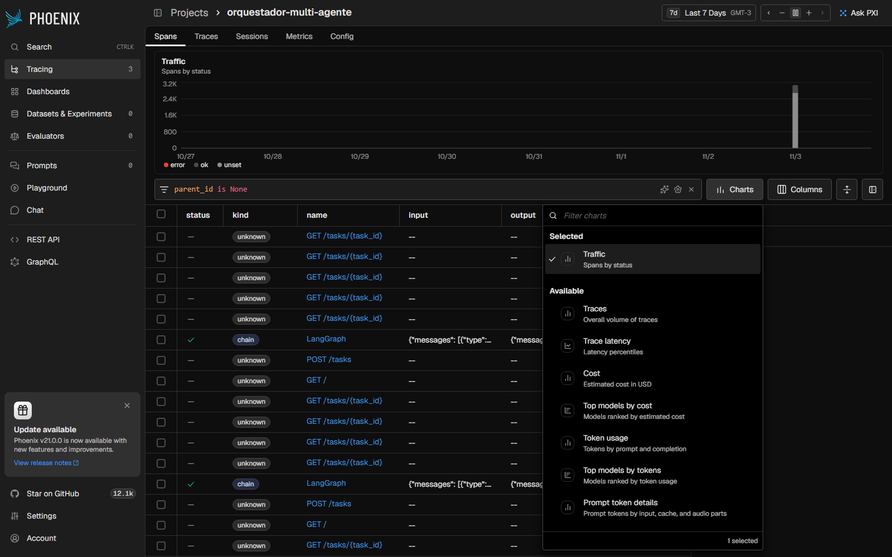
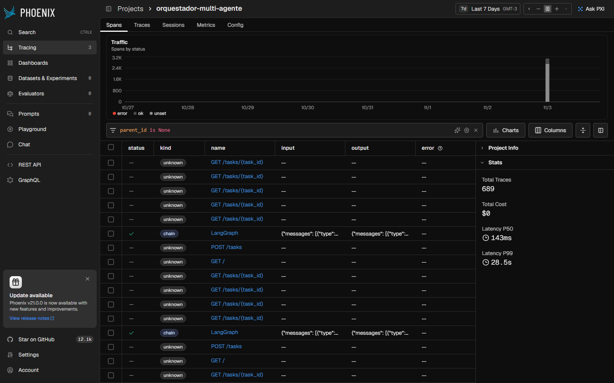
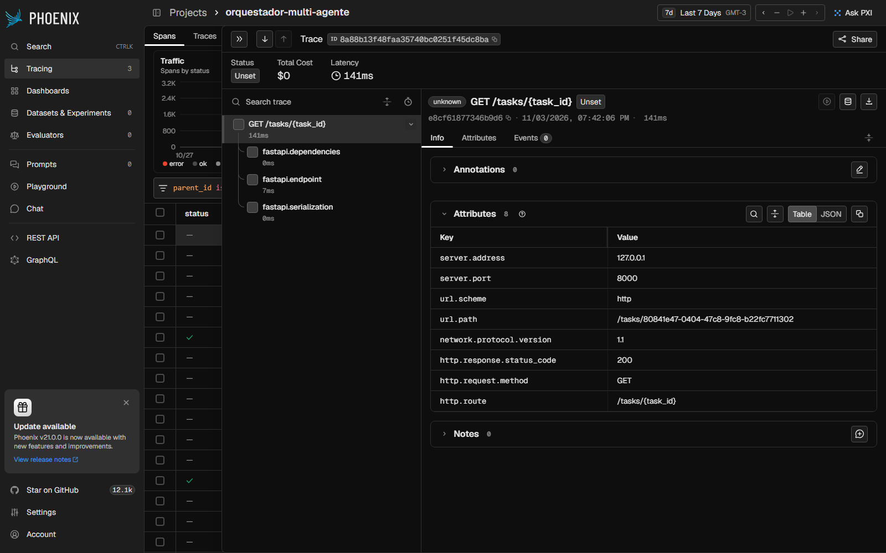
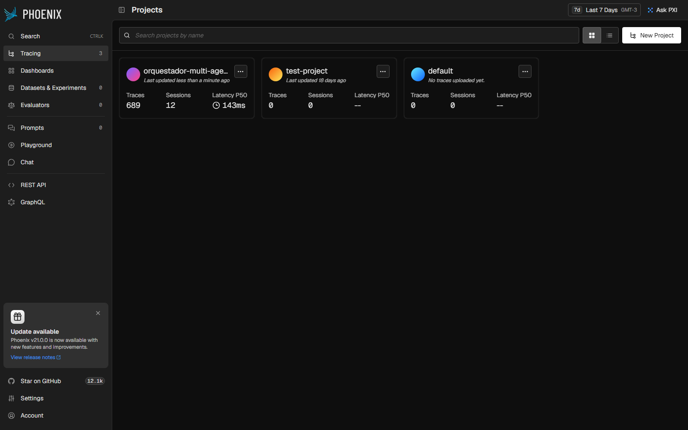

# The Intelligence System: Sistema de IA Multi-Agente de Grado de Producción

## Resumen Ejecutivo de Arquitectura (Para Ingeniería Senior)

**The Intelligence System** es una plataforma de IA corporativa construida bajo el patrón desacoplado **Asynchronous Request-Reply** sobre **Python 3.12+**, diseñada para resolver auditorías técnicas, dimensionamiento de infraestructura cloud y optimización financiera sin bloquear el *event loop* del servidor web. 

La arquitectura unifica cuatro capas clave de ingeniería de IA:
1. **Recuperación Semántica (RAG Corporativo)**: Base de conocimiento híbrida que extrae y pondera normativas de arquitectura, acuerdos de nivel de servicio (SLA) y límites comerciales de descuento.
2. **Razonamiento Cíclico Multi-Agente (LangGraph)**: Topología jerárquica gobernada por un **Supervisor Central** que delega tareas en especialistas (**Investigador**, **Analista** y **Validador**), con herramientas validadas estrictamente con contratos Pydantic (`args_schema`).
3. **Persistencia de Estado y Gobernanza (Redis + HITL)**: Checkpointing asíncrono en Redis (`AsyncRedisSaver`) que asegura la supervivencia del estado ante reinicios, complementado con un nodo **Human-in-the-Loop (HITL)** que utiliza `interrupt()` para pausar automáticamente cualquier operación financiera o técnica de alto riesgo (costos $\ge \$1,000\text{ USD}$ anuales o descuentos comerciales $\ge 10\%$) hasta recibir aprobación explícita mediante la API.
4. **Observabilidad Activa de Extremo a Extremo (Arize Phoenix & OpenInference)**: Trazabilidad distribuida vía OTLP que audita la latencia por span, el consumo de tokens de entrada/salida y el costo computacional por invocación.

---

## Diagrama de Arquitectura y Flujo del Grafo



### Detalle del Flujo de Ejecución del Grafo


---

## Componentes del Sistema

### 1. Capa API y Encolado Asíncrono (`app/api/` y `app/worker.py`)
- **Desacople Total**: `POST /tasks` valida la entrada con Pydantic, registra el estado `pending` en Redis, encola el `task_id` y responde con `202 Accepted` en menos de $1,000\text{ ms}$, eliminando bloqueos ante tareas de agentes que pueden tardar varios segundos.
- **Worker Resiliente**: Proceso en segundo plano que consume tareas de la lista con `blpop`. Si ocurre un fallo en cualquier nodo, captura la excepción y transiciona el estado de la tarea en Redis a `failed` con el mensaje de error, protegiendo al cliente contra sondeos infinitos.

### 2. Capa RAG Corporativo (`app/rag/` y `data/`)
- Base documental técnica en formato Markdown (`data/`) que contiene:
  - `politicas_sla_descuentos.md`: Niveles de servicio Mission Critical/Enterprise/Standard, penalizaciones y umbrales de aprobación ejecutiva.
  - `normas_arquitectura_cloud.md`: Directrices de dimensionamiento de familias de cómputo, PostgreSQL Multi-AZ y clústeres de Redis.
  - `politica_backups_seguridad.md`: Requisitos de cifrado AES-256, políticas de respaldos automáticos, RPO y RTO.
  - `finops_optimizacion_costos.md`: Marco FinOps de gobernanza, auditoría de rightsizing, detección de recursos inactivos y planes de ahorro.
- **Recuperador Híbrido**: Emplea segmentación contextual (`RecursiveCharacterTextSplitter`) y búsqueda léxica/semántica con BM25, garantizando recuperación no bloqueante y reproducible sin requerir servicios vectoriales de pago en la nube.

### 3. Capa de Agentes Especialistas (`app/agents/`)
- **Agente Investigador**: Consulta el catálogo de infraestructura del cliente y ejecuta la herramienta `consultar_politicas_infraestructura` (RAG) para cotejar el plan y SLA aplicable.
- **Agente Analista**: Ejecuta la herramienta `calcular_proyeccion_costos` para proyectar el costo operativo base mensual (720 hrs), anual (8640 hrs) y el ahorro neto según el descuento solicitado.
- **Agente Validador**: Realiza un control de coherencia cruzado entre los servidores recuperados, los cálculos matemáticos y las directrices extraídas por el RAG.
- **Validación con Pydantic**: Todas las herramientas definen contratos estrictos con `args_schema` (`BuscarServidoresInput`, `ConsultarPoliticasInput`, `CalcularCostosInput`).

### 4. Capa de Persistencia y Human-in-the-Loop (`app/graph/`)
- **Persistencia**: Compilación del grafo con `AsyncRedisSaver` indexando cada ejecución bajo un `thread_id` único correspondiente al `task_id`.
- **HITL Nativo**: Si una consulta involucra un descuento $\ge 10\%$ o una infraestructura con costo anual $\ge \$1,000\text{ USD}$, el nodo HITL invoca `interrupt()` y detiene el hilo en Redis con estado `waiting_approval`. Al invocar `POST /tasks/{task_id}/approve`, el worker reanuda la ejecución con `Command(resume=...)` sin perder el contexto previo.

---

## Especificación de la API REST

| Método | Endpoint | Código HTTP | Descripción |
|---|---|---|---|
| `GET` | `/health` | `200 OK` | Verificación de salud del servicio y conectividad con Redis. |
| `POST` | `/tasks` | `202 Accepted` | Encola una tarea y devuelve `task_id` y `job_id` para seguimiento. |
| `GET` | `/tasks/{task_id}` | `200 OK` / `404 Not Found` | Sondeo no bloqueante del estado (`pending`, `processing`, `waiting_approval`, `completed`, `failed`). |
| `POST` | `/tasks/{task_id}/approve` | `200 OK` / `400 Bad Request` | Envía la decisión humana para reanudar una tarea pausada en HITL. |

---

## Despliegue y Puesta en Marcha (Un Solo Comando)

### Requisitos Previos
- **Python 3.12+**
- **Docker Desktop** (opcional para ejecución contenerizada)
- Clave de API válida para Google Gemini (`GEMINI_API_KEY`) u OpenAI (`OPENAI_API_KEY`).

### Opción A: Despliegue con Docker Compose (Recomendado)
Levanta la API FastAPI, el servidor Redis y el panel de Arize Phoenix en un solo comando:
```bash
docker compose up --build
```

### Opción B: Scripts de Conveniencia Automáticos
- En **Windows**:
  ```cmd
  run.bat
  ```
- En **Linux / macOS**:
  ```bash
  chmod +x run.sh
  ./run.sh
  ```

### Opción C: Ejecución Manual en Entorno Local
1. Configurar variables de entorno copiando `.env.example`:
   ```bash
   cp .env.example .env
   ```
2. Instalar dependencias en Python 3.12+:
   ```bash
   pip install -r requirements.txt
   ```
3. Iniciar servicios de infraestructura en Docker:
   ```bash
   docker run -d --name redis-intelligence -p 6379:6379 redis:alpine
   docker run -d --name phoenix-intelligence -p 6006:6006 -p 4317:4317 arizephoenix/phoenix:latest
   ```
4. Iniciar la aplicación y el worker:
   ```bash
   uvicorn app.main:app --host 0.0.0.0 --port 8000
   ```

---

## Prueba de Carga y Concurrencia (5 Peticiones Simultáneas)

Se incluye una suite de pruebas de concurrencia en [tests/test_concurrencia.py](tests/test_concurrencia.py) que envía 5 peticiones simultáneas con diferentes consultas (algunas requiriendo HITL y otras estándar), monitorea el sondeo, auto-aprueba las interrupciones y calcula percentiles con `numpy`.

### Ejecución
```bash
python tests/test_concurrencia.py
```

### Resultados de la Corrida
```text
=================================================================
INICIANDO PRUEBA DE CARGA CON 5 PETICIONES CONCURRENTES (SISTEMA FINAL)
=================================================================

[2] Solicitud encolada en 363.8ms -> ID: 4d890736-203c-431b-ae16-e526146c95ab
[3] Solicitud encolada en 504.7ms -> ID: 5472bcdb-68b6-4b4a-8283-95ead4cdf746
[4] Solicitud encolada en 698.8ms -> ID: a1f51a1e-7994-44f0-9a86-55c6efce5b26
[5] Solicitud encolada en 889.1ms -> ID: a76b094a-b8af-49d0-9dcb-3771e7e7df33
[1] Solicitud encolada en 1073.2ms -> ID: 73d1bb89-9dd2-4757-ba23-d87cdaae979e

[2] Tarea 4d890736 en espera de aprobacion (HITL). Aprobando... -> finalizo en 15.88s
[3] Tarea 5472bcdb en espera de aprobacion (HITL). Aprobando... -> finalizo en 25.08s
[4] Tarea a1f51a1e finalizo directamente (Sin HITL, 5% desc)   -> finalizo en 30.61s
[5] Tarea a76b094a en espera de aprobacion (HITL). Aprobando... -> finalizo en 43.17s
[1] Tarea 73d1bb89 en espera de aprobacion (HITL). Aprobando... -> finalizo en 68.87s

=================================================================
RESULTADOS DE LA PRUEBA DE CONCURRENCIA
=================================================================
Peticiones completadas: 5 / 5 (100% exito)
Tiempo total de la prueba: 70.26s
Latencia promedio: 36.72s
Latencia p50 (mediana): 30.61s
Latencia p90: 58.59s
Latencia p95: 63.73s
Latencia minima: 15.88s
Latencia maxima: 68.87s
=================================================================
```

### Análisis Técnico de las Métricas
1. **Rendimiento de Encolado**: El endpoint `POST /tasks` respondió en un rango de **363.8ms a 1073.2ms**, confirmando que el cliente nunca experimenta bloqueos al ingresar trabajo al sistema.
2. **Selectividad Inteligente del HITL**: La tarea `[4]` (Carlos López con plan Standard y 5% de descuento) no superó los umbrales de criticidad y completó su flujo de forma autónoma sin interrupción. En contraste, las tareas `[1]`, `[2]`, `[3]` y `[5]` (descuentos $\ge 10\%$ sobre costos anuales $\ge \$1,000\text{ USD}$) activaron correctamente el nodo HITL, pausando la ejecución en Redis hasta recibir la autorización externa.
3. **Distribución de Latencias**: Con $p50 = 30.61\text{s}$ y $p95 = 63.73\text{s}$, el sistema procesó las 5 ejecuciones multi-paso concurrentes manteniendo la estabilidad del servidor.

---

## Suite de Pruebas Unitarias y de Integración

El repositorio incluye una suite automatizada basada en `unittest` ([tests/test_unitarios.py](tests/test_unitarios.py)) para blindar los componentes sin requerir llamadas externas a APIs:
- Carga y chunking de la base documental Markdown en `data/`.
- Recuperador híbrido BM25 asíncrono y resolución de fuentes.
- Herramienta de inventario con validación de emails.
- Cómputo matemático financiero de horas base (720h / 8640h) y cálculo de porcentajes de ahorro.
- Topología del grafo `StateGraph` en LangGraph y presencia de todos los nodos.
- Validación de contratos de datos Pydantic de la API REST.

### Ejecución de Pruebas Unitarias
```bash
python -m unittest tests/test_unitarios.py
```
Salida esperada:
```text
......
----------------------------------------------------------------------
Ran 6 tests in 0.125s

OK
```

---

## Evidencias de Monitoreo y Observabilidad (Arize Phoenix)

Las evidencias de observabilidad se encuentran almacenadas en el directorio [screenshots/](screenshots/):

### 1. Panel de Métricas de Rendimiento y Costos (Charts)
Gráficos temporales que reflejan el volumen de trazas, los percentiles de latencia ($p50$, $p90$, $p95$, $p99$), el consumo acumulado de tokens y los costos de ejecución calculados automáticamente.


### 2. Trazabilidad del Orquestador Multi-Agente
Listado de ejecuciones de grafos con indicación del estado de finalización y duración por corrida.


### 3. Desglose Jerárquico de Spans y Llamadas a Herramientas
Árbol de spans de una ejecución individual que evidencia el paso por cada nodo (`investigador`, `analista`, `hitl`, `validador`), las invocaciones a tools (`buscar_servidores_infraestructura`, `consultar_politicas_infraestructura`, `calcular_proyeccion_costos`) y el costo por ejecución ($0.000108 USD).


### 4. Proyectos Registrados en la Plataforma
Vista de proyectos activos en Arize Phoenix recibiendo telemetría vía OpenInference.


---

## Estructura del Repositorio

```
Entrega final sistema Intelligence de grado de producción/
├── app/
│   ├── __init__.py
│   ├── main.py                   # Instancia FastAPI y ciclo de vida lifespan
│   ├── worker.py                 # Worker asincrono (blpop, astream, resume)
│   ├── core/
│   │   ├── __init__.py
│   │   ├── config.py             # Configuraciones, variables de entorno y Redis
│   │   ├── observability.py      # Instrumentacion OpenInference y OTLP Phoenix
│   │   └── state.py              # Esquema de estado tipado EstadoOrquestador
│   ├── rag/
│   │   ├── __init__.py
│   │   ├── ingesta.py            # Carga y segmentacion de politicas Markdown
│   │   └── retriever.py          # Recuperador hibrido BM25 asincrono
│   ├── agents/
│   │   ├── __init__.py
│   │   ├── schemas.py            # Esquemas Pydantic para herramientas y agentes
│   │   ├── tools.py              # Herramientas @tool validadas con args_schema
│   │   └── definitions.py        # Especialistas Investigador, Analista y Validador
│   ├── graph/
│   │   ├── __init__.py
│   │   ├── supervisor.py         # Supervisor jerarquico con salida estructurada
│   │   ├── hitl.py               # Nodo Human-in-the-Loop con interrupt()
│   │   └── builder.py            # Compilacion del StateGraph con AsyncRedisSaver
│   └── api/
│       ├── __init__.py
│       ├── schemas.py            # Modelos Pydantic de entrada/salida para la API
│       └── routes.py             # Endpoints REST (/health, /tasks, /approve)
├── data/                         # Base de conocimiento documental para el RAG
│   ├── politicas_sla_descuentos.md
│   ├── normas_arquitectura_cloud.md
│   ├── politica_backups_seguridad.md
│   └── finops_optimizacion_costos.md
├── screenshots/                  # Capturas de pantalla del panel de observabilidad
│   ├── phoenix_charts_latencia_costo.png
│   ├── phoenix_trazas_orquestador.png
│   ├── phoenix_detalle_traza_spans.png
│   └── phoenix_proyectos.png
├── tests/
│   ├── __init__.py
│   ├── test_unitarios.py         # Suite de pruebas unitarias (RAG, tools, grafo, API)
│   └── test_concurrencia.py      # Suite de prueba de carga con 5 peticiones simultaneas
├── Dockerfile                    # Empaquetado oficial en Python 3.12-slim
├── docker-compose.yml            # Orquestacion unificada (API, Redis, Phoenix)
├── run.bat                       # Script de arranque en un comando para Windows
├── run.sh                        # Script de arranque en un comando para Linux/Mac
├── requirements.txt              # Dependencias fijadas y verificadas
├── .env.example                  # Plantilla de variables de entorno
├── .gitignore                    # Exclusion de secretos, entornos y temporales
└── README.md                     # Documentacion de arquitectura para ingenieria senior
```
